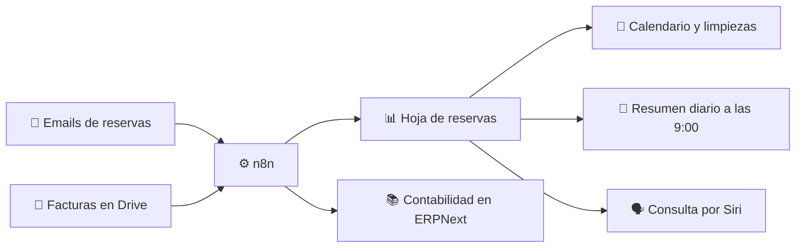

<h1 align="center">Hola, soy Alfonso 👋</h1>

---

## 🧭 Sobre mí

Desde 2020 he montado y dirigido **cuatro negocios propios**, con mi dinero en juego y la cuenta de resultados a mi cargo. Eso enseña a decidir con números antes que con intuiciones. Soy de **Sevilla** (con los veranos en Islantilla) y ahora llevo esa experiencia a **construir producto**: plataformas para el sector inmobiliario y automatización de procesos con IA.

<table align="center">
<tr>
<td align="center"><h3>4</h3>negocios propios desde 2020</td>
<td align="center"><h3>85%</h3>ocupación media en alquiler vacacional</td>
<td align="center"><h3>4,2/5</h3>nota media en reseñas entre plataformas</td>
<td align="center"><h3>+1.000</h3>colaboradores en la red que construí en eventos</td>
</tr>
</table>

## 💻 En qué estoy trabajando

| | Proyecto | Qué es |
|---|---|---|
| 🏠 | **OIKAI** | Participo en el desarrollo de una plataforma de gestión a medida para media estancia |
| 🏖️ | **WellHome Rentals** | Gestión de alquileres vacacionales, de media y larga estancia, con la operativa automatizada en n8n |

## 🏢 OIKAI

**OIKAI** es una plataforma de gestión a medida para gestores de habitaciones y apartamentos de media estancia. *Tu alquiler por habitaciones, en piloto automático.* Participo en el desarrollo del producto junto al equipo técnico, trabajando con Claude Code y Lovable sobre un repositorio de GitHub.

| | |
|---|---|
| 🏠 **Gestión** | Propiedades, contratos, cobros, incidencias y mensajes |
| 💶 **Rentabilidad** | Margen real por inmueble y habitación, con alertas |
| 🌐 **Portal de reservas** | Web pública con marca propia para captar reservas |
| 🤖 **IA y automatización** | Asistente en lenguaje natural y tareas automatizadas |
| 🧾 **Liquidaciones** | Informes y liquidaciones a propietarios |

👉 Más información en [oikai.es](https://oikai.es)

## 🏖️ WellHome Rentals

Gestión de **alquileres vacacionales, de media y larga estancia**, de principio a fin: reservas, limpieza, comunicación con huéspedes, proveedores y contabilidad. Los precios los fijo yo, cruzando la ocupación con lo que hace la competencia y con los eventos de la ciudad.

- 📈 **85 %** de ocupación media
- ⭐ **4,2 / 5** de nota media entre todas las plataformas
- 🤖 Operativa diaria automatizada con **n8n** (ver abajo)

## ⚙️ Automatización con n8n

Tengo montado un servidor de **n8n** que lleva buena parte de la operativa en piloto automático. Webhooks, triggers de Gmail y Drive, tareas programadas e integración con la API de ERPNext:

| Workflow | Disparador | Qué hace |
|---|---|---|
| **Alta de reservas** | Gmail, email de confirmación | Guarda cada reserva nueva en Google Sheets |
| **Resumen diario** | Programado, 9:00 | Entradas, salidas y agenda de limpieza |
| **Calendario** | Programado | Bloques de limpieza con el número de huéspedes de cada día |
| **Consulta por voz** | Webhook GET desde un Atajo de Siri | Responde qué pasa hoy y mañana, días libres y próxima reserva |
| **Facturas a contabilidad** | Drive, nueva factura | Comprueba o crea el proveedor y crea la factura en ERPNext por API |
| **Reconciliación** | Manual | Cruza reservas y emails para detectar las que faltan, cambian o se cancelan |

## 🎟️ Tricket

Plataforma de gestión de ticketing para eventos que desarrollé en equipo entre 2025 y 2026. Conozco el problema desde dentro: organicé eventos universitarios con UNight en Sevilla, Huelva y Cádiz.

## 🛤️ Trayectoria

| Etapa | Qué hice |
|---|---|
| **2026 a hoy** | **OIKAI**: desarrollo de una plataforma de gestión de alquileres para media estancia |
| **2025 a hoy** | **WellHome Rentals**: gestión de alquileres vacacionales, de media y larga estancia, con automatización en n8n |
| **2025 a 2026** | **Tricket**: desarrollo de una plataforma de gestión de ticketing para eventos |
| **2023 a 2025** | **Mad Club Islantilla**: cofundador y CEO de un local de hostelería de temporada. Presupuestos, caja, proveedores, patrocinadores y equipo de hasta 15 personas |
| **2021 a 2026** | **UNight S.L.**: fundador y CEO. Eventos universitarios en Sevilla, Huelva y Cádiz, con una red de más de 1.000 colaboradores y más de 20 locales asociados |
| **2020 a 2022** | **Waikiki Club Islantilla**: cofundador y encargado de un pub de temporada. Tesorería, personal, proveedores y promoción en redes |

## 🎓 Formación

- 🎓 **Administración y Dirección de Empresas**, Universidad Europea de Madrid
- 🎯 **Programa LYDES**, San Telmo Business School

## 🛠️ Herramientas que uso

## 📫 Hablamos

¿Tienes un proyecto o una oportunidad de la que quieras hablar? Escríbeme por [LinkedIn](https://www.linkedin.com/in/alfonsomazaosuna/), [Instagram](https://www.instagram.com/alfonso.maza) o a [fonzymazai@gmail.com](mailto:fonzymazai@gmail.com).

