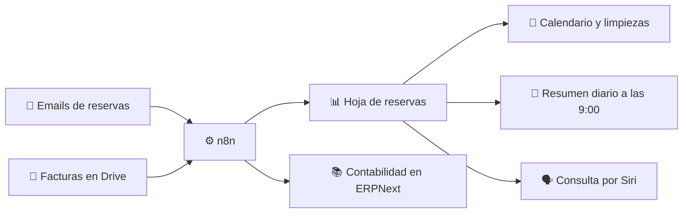

<h1 align="center">Hola, soy Alfonso 👋</h1>

---

## 🧭 Sobre mí

Desde 2020 he montado y dirigido **cuatro negocios propios**, con mi dinero en juego y la cuenta de resultados a mi cargo. Eso enseña a decidir con números antes que con intuiciones. Soy de **Sevilla** (con los veranos en Islantilla) y mi terreno es la estrategia, las finanzas y el desarrollo de negocio, cada vez más cerca del **real estate** y de la **automatización con IA**.

<table align="center">
<tr>
<td align="center"><h3>4</h3>negocios propios desde 2020</td>
<td align="center"><h3>85%</h3>ocupación media en alquiler vacacional</td>
<td align="center"><h3>4,2/5</h3>nota media en reseñas entre plataformas</td>
<td align="center"><h3>15</h3>personas en los equipos que he dirigido</td>
</tr>
</table>

## 🚀 Lo que hago hoy

| | Proyecto | Qué es |
|---|---|---|
| 🏠 | **OIKAI** | Plataforma de gestión a medida para media estancia |
| 🏖️ | **WellHome Rentals** | Gestión de alquileres vacacionales, de media y larga estancia |
| 🤝 | **Tricket** | Venture builder |

## 🏢 OIKAI

**OIKAI** es una plataforma de gestión a medida para gestores de habitaciones y apartamentos de media estancia. *Tu alquiler por habitaciones, en piloto automático.*

| | |
|---|---|
| 🏠 **Gestión** | Propiedades, contratos, cobros, incidencias y mensajes |
| 💶 **Rentabilidad** | Margen real por inmueble y habitación, con alertas |
| 🌐 **Portal de reservas** | Web pública con marca propia para captar reservas |
| 🤖 **IA y automatización** | Asistente en lenguaje natural y tareas automatizadas |
| 🧾 **Liquidaciones** | Informes y liquidaciones a propietarios |

👉 Más información en [oikai.es](https://oikai.es)

## 🏖️ WellHome Rentals

Gestión de **alquileres vacacionales, de media y larga estancia**. Fijo yo los precios y llevo la operativa diaria: reservas, limpieza, comunicación con huéspedes y contabilidad.

- 📈 **85 %** de ocupación media
- ⭐ **4,2 / 5** de nota media entre todas las plataformas
- 🧠 Decisiones de precio basadas en datos, no en intuición

## ⚙️ Automatización con n8n

Tengo montado un servidor de **n8n** que lleva buena parte de la operativa en piloto automático:

- 📥 **Alta automática de reservas** a partir de los emails de confirmación
- 📅 **Calendario sincronizado**, con bloques de limpieza y número de huéspedes
- 🌅 **Resumen diario** de entradas, salidas y agenda de limpieza
- 🗣️ **Consulta de reservas por voz** con un Atajo de Siri
- 🧾 **Facturas de proveedores** que entran solas en la contabilidad (ERPNext)
- 🔄 **Reconciliación** de reservas contra los emails para detectar cambios y cancelaciones

## 🛤️ Trayectoria

| Etapa | Qué hice |
|---|---|
| **2025 a hoy** | **WellHome Rentals**: gestión de alquileres vacacionales, de media y larga estancia |
| **2025 a 2026** | **Tricket**: venture builder |
| **2020 a 2026** | **UNight S.L.** y dos negocios de hostelería: presupuestos, tesorería, proveedores y equipos de hasta 15 personas |
| **2017 a 2021** | Relaciones públicas en el mundo de la noche y los eventos |

## 🎓 Formación

- 🎓 **Administración y Dirección de Empresas**, Universidad Europea de Madrid
- 🎯 **Programa LYDES**, San Telmo Business School

## 🛠️ Herramientas que uso

## 📫 Hablamos

¿Tienes un proyecto o una oportunidad de la que quieras hablar? Escríbeme por [LinkedIn](https://www.linkedin.com/in/alfonsomazaosuna/), [Instagram](https://www.instagram.com/alfonso.maza) o a [fonzymazai@gmail.com](mailto:fonzymazai@gmail.com).

